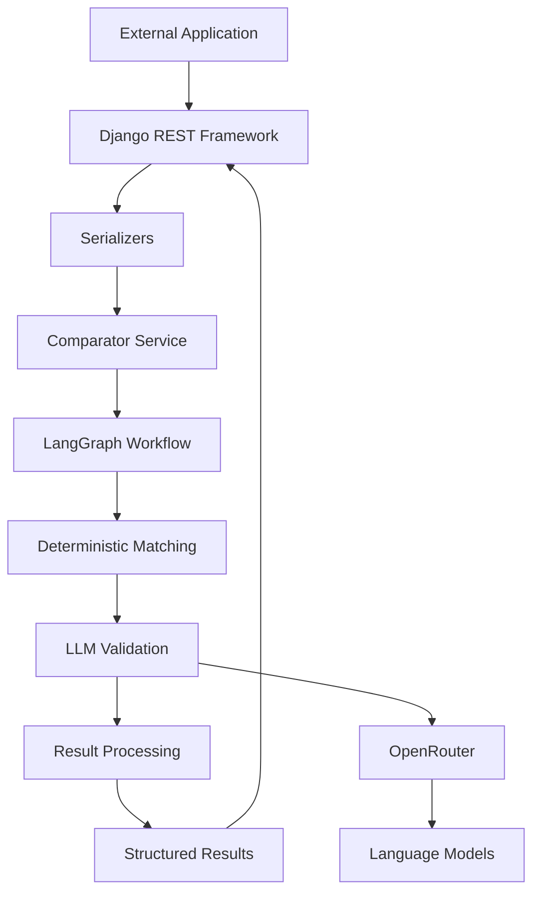

# AI-Powered Political Party Entity Resolution

An AI-powered entity resolution service designed to identify potentially identical political parties and electoral candidatures across electoral datasets.

The project combines deterministic similarity algorithms with Large Language Models (LLMs) to evaluate candidate matches, resolve ambiguous cases and improve consistency in political party identification.

## Architecture

The application follows a modular architecture, separating API management, comparison orchestration and AI processing.

### Main components

**API Layer — Django REST Framework**

Exposes the comparison functionality through a REST API, handling incoming requests, authentication and data validation.

**Application Layer — Comparator Service**

Coordinates the comparison process and acts as the entry point to the AI workflow, keeping HTTP concerns separate from AI orchestration.

**AI Orchestration — LangGraph**

Implements a multi-step workflow that coordinates candidate matching, semantic validation and result processing.

**Deterministic Matching**

Uses similarity-based comparisons of party names and acronyms to identify potential matches before relying on LLM-based reasoning.

**LLM Validation — LangChain and OpenRouter**

Integrates external language models to evaluate ambiguous party similarities and provide semantic validation.

**Structured Outputs — Pydantic**

Defines structured data contracts for LLM responses, making model outputs easier to validate and consume programmatically.

## Technology Stack

| Technology | Purpose |
|---|---|
| Python | Main programming language |
| Django | Backend framework |
| Django REST Framework | REST API and request validation |
| LangGraph | Multi-step AI workflow orchestration |
| LangChain | LLM integration and model interaction |
| OpenRouter | LLM provider integration |
| Pydantic | Structured output schemas and validation |
| Docker | Application containerisation |
| Gunicorn | WSGI application server |

## Engineering Approach

The project explores a hybrid approach to entity resolution, combining deterministic algorithms with probabilistic LLM-based reasoning.

Key engineering considerations include:

- **Hybrid AI architecture:** combining rule-based matching with semantic analysis.
- **Workflow orchestration:** structuring AI operations as independent, coordinated steps.
- **Separation of concerns:** isolating AI processing from the main application and its business logic.
- **Structured model outputs:** reducing ambiguity when integrating LLM responses into backend workflows.
- **Service independence:** exposing AI capabilities through an API that can be consumed by other applications.

## Integration Context

The service is part of a broader electoral analytics ecosystem, where it supports the identification and comparison of political parties across different elections and electoral datasets.

Its independent API architecture allows the main business application to delegate AI-intensive operations to a dedicated Python service without coupling its core backend to specific LLM frameworks or providers.

## Future Development

Areas identified for further development include:

- Automated testing of individual workflow nodes and end-to-end execution.
- Evaluation datasets and measurable model performance (precision, recall and F1-score).
- Model and prompt benchmarking.
- Improved workflow routing and deterministic execution paths.
- Error handling, observability and execution tracing.

## Author

**Daniel Besteiro Rodríguez**

Backend Software Engineer focused on backend architecture, API development and AI-powered applications.

- Website: https://danybesteiro.dev
- GitHub: https://github.com/DanyBesteiro
